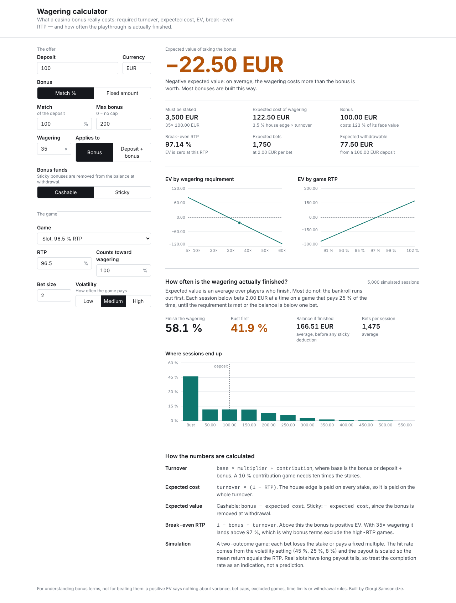

# Wagering calculator

What a casino bonus really costs. Enter the offer and the game; get the required turnover, the expected cost of grinding through it, the EV of accepting the bonus, the RTP at which it breaks even — and a Monte Carlo estimate of how often the playthrough is actually finished before the bankroll runs out.

[](https://github.com/samsonidze/wagering-calculator/actions/workflows/ci.yml)

**Live:** https://wagering-calculator.vercel.app



## Why

I spent a year on the operator and affiliate side of iGaming. The single most misunderstood thing about bonuses — by players and by junior marketing staff alike — is that the headline multiplier is not the cost. A "35x" bonus on a 96 % slot means staking 35 times the bonus and paying the house edge on all of it, which costs more than the bonus is worth. And even that understates it, because EV is an average over players who finish: most bust first.

This tool makes both facts visible and lets you change one input at a time to see what moves the result.

## What it models

| Input | Why it matters |
|---|---|
| Deposit, match %, cap / fixed bonus | How much bonus money is actually credited |
| Wagering multiplier and base (bonus vs deposit + bonus) | The latter doubles the turnover on a 100 % match |
| Game RTP and contribution % | Table games typically count 10 %, so 99.5 % blackjack is *worse* than a 96 % slot for clearing a bonus |
| Cashable vs sticky | A sticky bonus is removed at withdrawal, so it can never be positive EV |
| Bet size and volatility | Do not change EV at all — but decide whether you survive to the end |

Outputs: turnover, expected cost, EV, break-even RTP, expected number of bets, expected withdrawable amount, cost per unit of bonus; EV curves across multipliers (5–60×) and RTPs (90–102 %); and from the simulation, completion rate, average balance when completed, and a histogram of final balances.

## The maths

```
turnover        = base × multiplier ÷ contribution
expected cost   = turnover × (1 − RTP)
EV (cashable)   = bonus − expected cost
EV (sticky)     = − expected cost
break-even RTP  = 1 − bonus ÷ turnover
```

The simulation uses a two-outcome game — each bet loses the stake or pays a fixed multiple — with the hit rate set by the volatility preset (45 % / 25 % / 8 %) and the payout scaled so the mean return equals the RTP. It is deliberately simple: real slots have long payout tails, so the completion rate is an indication, not a prediction. 5,000 sessions are run per input change, in a Web Worker so typing stays smooth, with a seeded PRNG so results are reproducible.

A result that surprises most people: higher volatility *raises* the mean final balance even though it lowers the completion rate. Busting caps the downside at the bankroll; the expected cost of the full turnover is only paid by those who get there.

## Built with

React 18 · TypeScript · Vite · Tailwind CSS 4 · Recharts · Vitest · Web Workers

```
src/lib/bonus.ts       Pure functions: calculate(), evByMultiplier(), evByRtp(), game presets
src/lib/simulate.ts    simulate(), seedable PRNG, histogram bucketing
src/worker/            Worker entry that runs simulate() off the main thread
src/hooks/             useSimulation: debounce, stale-reply guard, worker lifecycle
src/components/        Inputs, Results, Charts (lazy), Simulation, Method
```

`npm test` covers the maths against worked examples (the textbook 100 % / 35× / 96 % case, deposit+bonus wagering, low-contribution games, sticky bonuses, the EV zero-crossing) and the simulation's invariants (payout calibration to RTP, monotonic completion rate vs volatility, bet cap, bucket sizing).

## Run it

```bash
npm install
npm run dev
npm test
npm run build
```

Static site, no backend, no environment variables. Deploys to Vercel or any static host as-is.

## Not included, on purpose

Max-bet rules, excluded games, time limits, max cashout and "bonus abuse" clauses are where real terms get sharp, and they differ by operator. The calculator tells you what the arithmetic says; read the terms for the rest.
